

  
  <h1>HyperNotch</h1>
  

    <strong>Ultra-fluid Dynamic Island &amp; MacBook Air-style Notch for Windows 10 &amp; Windows 11</strong> 
    Native 240 FPS animations, real-time telemetry, media controls, and custom themes.
  

  

    
    
    
    
  

  

    <a href="../../releases">Download</a> &nbsp;&bull;&nbsp;
    <a href="#showcase">Showcase</a> &nbsp;&bull;&nbsp;
    <a href="#features">Features</a> &nbsp;&bull;&nbsp;
    <a href="https://discord.gg/XybV5VC4mx">Discord</a>
  

---

<h2 id="showcase">Showcase</h2>

  <table>
    <tr>
      <td align="center" width="33%">
        <strong>Media Control</strong> 
        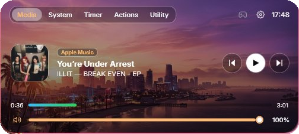
      </td>
      <td align="center" width="33%">
        <strong>System Telemetry</strong> 
        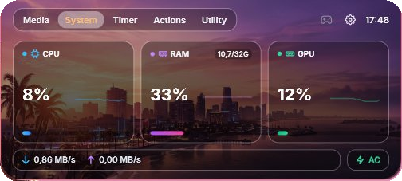
      </td>
      <td align="center" width="33%">
        <strong>Notch &amp; Display</strong> 
        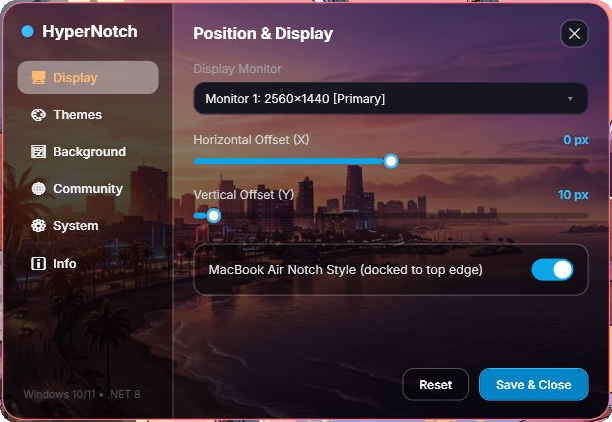
      </td>
    </tr>
  </table>

  
<strong>View all screenshots (Timer, Actions, Utility, Themes, Community &amp; Settings)</strong>

   
  

    <table>
      <tr>
        <td align="center" width="33%">
          <strong>Focus Timer</strong> 
          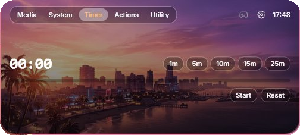
        </td>
        <td align="center" width="33%">
          <strong>Quick Actions</strong> 
          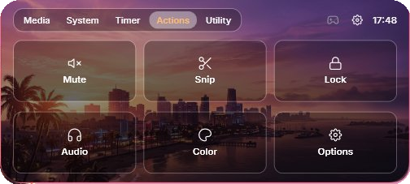
        </td>
        <td align="center" width="33%">
          <strong>Utility Hub</strong> 
          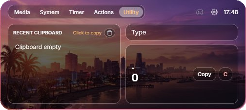
        </td>
      </tr>
      <tr>
        <td align="center" width="33%">
          <strong>Visual Themes</strong> 
          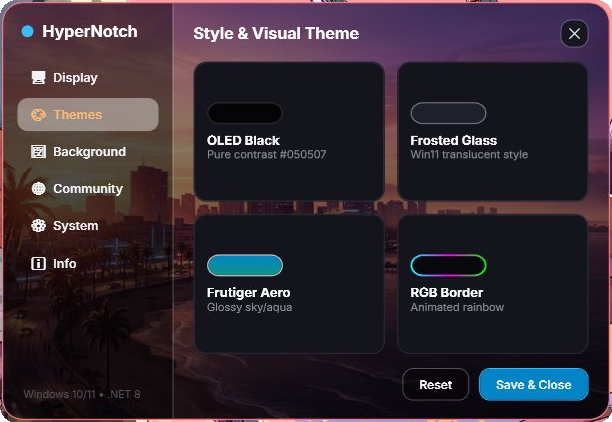
        </td>
        <td align="center" width="33%">
          <strong>Background Colors</strong> 
          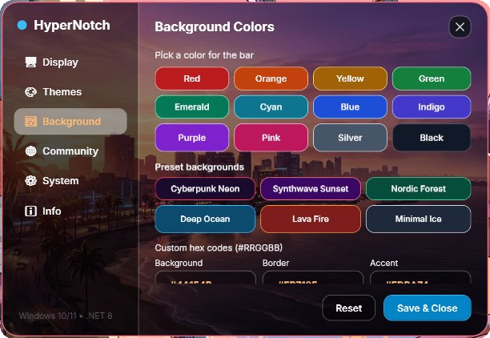
        </td>
        <td align="center" width="33%">
          <strong>Community Wallpapers</strong> 
          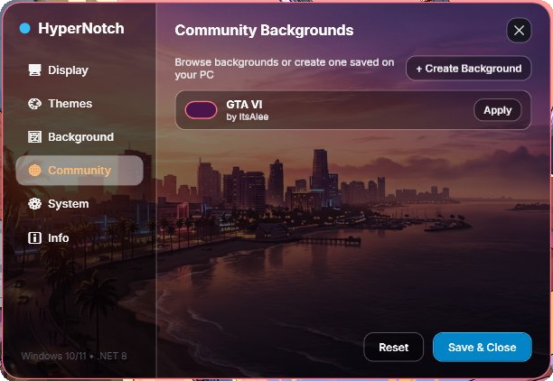
        </td>
      </tr>
      <tr>
        <td align="center" width="50%">
          <strong>System &amp; 11 Languages</strong> 
          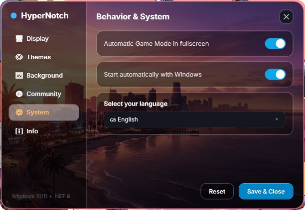
        </td>
        <td align="center" width="50%">
          <strong>About &amp; Creator</strong> 
          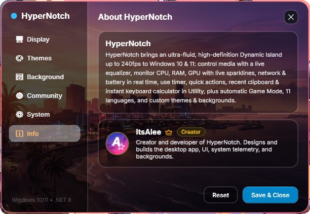
        </td>
      </tr>
    </table>
  

---

<h2 id="features">Key Features</h2>

- **Floating Pill or MacBook Air Notch Mode**: Switch anytime in *Settings -> Display* between the classic floating pill and a MacBook Air-style notch docked flush to the top edge of your screen.
- **Up to 240 FPS Fluidity**: Hardware-accelerated exponential animations with Per-Monitor V2 DPI scaling.
- **Universal Media Controls**: Live album art, playback timeline, Play/Pause/Next/Previous, 60 FPS equalizer, and mouse-wheel volume control for Spotify, Apple Music, YouTube (Chrome/Edge), VLC, and any Windows media session.
- **Real-Time Telemetry**: Live sparkline graphs for CPU, RAM, GPU, network speeds (`MB/s`), and battery/AC power.
- **Focus Timer, Quick Actions &amp; Utility**: Quick presets (`1m`–`25m`), 6 instant system actions, clipboard history, and instant keyboard calculator.
- **Automatic Game Mode**: Automatically detects fullscreen games and makes the bar click-through while you play.
- **11 Languages**: Italian, English, Spanish, French, German, Portuguese, Japanese, Chinese, Korean, Russian, and Arabic.

---

<h2 id="download">Download &amp; Installation</h2>

1. Open the **[Releases](../../releases)** page and download **`HyperNotch_Setup.exe`**.
2. Run **`HyperNotch_Setup.exe`** and follow the quick setup wizard (no external `.NET` installation required).
3. Access settings anytime from the **System Tray** menu or the gear icon inside the bar.

---

<h2>Community &amp; Copyright</h2>

- **Discord Community**: https://discord.gg/XybV5VC4mx
- **Copyright © 2026 HyperNotch** — Created and developed by **ItsAlee**. All rights reserved.
- HyperNotch is an independent project and is not affiliated with Microsoft Corporation, Apple Inc., Spotify AB, Rockstar Games, or any other third-party brands.
